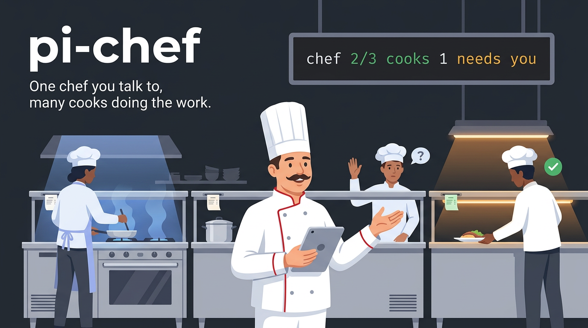

# pi-chef

[](https://github.com/bpauli/pi-chef/actions/workflows/validate.yml)



**One chef you talk to, many cooks doing the work.**

`pi-chef` is a [Pi](https://pi.dev) package. It turns one Pi session into a chef. The chef splits your request into tasks and hands each task to a cook. A cook is a child Pi process in its own git worktree, on its own branch. The chef wakes up when a cook is done, needs a decision, is blocked, or failed. You talk only to the chef.

It is a **kitchen of Pi processes**, not a terminal multiplexer and not a merge bot. Each cook does one task on one branch. The chef does the judgment: it writes the briefs, reviews the diffs, answers the cooks, and asks you only the real questions. You decide what lands.

A widget below the Pi editor shows the live board. It shows each open task, its state, the model of its cook, what the cook does now, and its age:

```text
chef  2/3 cooks  1 needs you
● api-7   cooking         anthropic/claude-sonnet-5-5  bash: make test  6m
! web-2   needs decision  openai/gpt-6-astra           keep the cookie session or move to bearer tokens?  2m
● docs-3  cooking         anthropic/claude-haiku-5     edit: docs/install.md  40s
```

## Install

```sh
pi install git:github.com/bpauli/pi-chef
```

Requirements:

- Pi 1.0.3 or later.
- Node 22.19 or later.
- git.
- Linux or macOS. chef finds its cooks by their stdout: through `/proc` on Linux, and through `lsof` on macOS. `lsof` ships with macOS.

chef itself depends on no terminal multiplexer and no other Pi package. Optional add-ons connect it to herdr, to pi-subagents, and to a recipe. See [Add-ons](#add-ons).

## Quick Start

### 1. Start a chef session

```sh
pi --chef
```

Or type `/chef` in a running Pi session. A normal Pi session has no chef tools and no chef state.

To give a prompt on the command line, put `--chef` before `-p`: `pi --chef -p "..."`. In Pi 1.0.3, a boolean extension flag that comes directly before the prompt takes the prompt as its value, and no run starts.

### 2. Ask for work

```text
> Add rate limiting to the api login route, and fix the web login redirect bug.
```

The chef registers the repositories, writes one brief per task, dispatches two cooks, and stops. It does not poll. You can continue to talk to it while the cooks work.

### 3. Get the kitchen update

When a cook ends its run, one kitchen update starts a chef turn:

```text
Kitchen update (2):
- api-7 "Add rate limiting to /login" is done: token bucket in limit.go, make test passes. Review with chef_result api-7.
- web-2 "Fix login redirect" needs a decision: keep the cookie session or move to bearer tokens? Answer with chef_send web-2.
```

### 4. Review, answer, close

The chef reads the diff of `api-7` in its worktree and tells you what is on which branch, with the evidence. It asks you the one real question from `web-2` and gives your answer to the cook. When the work has landed, it closes the task, and the worktree goes away.

## What It Feels Like

- Ask for three changes in two repositories in one message. Three cooks start in parallel, each on its own branch.
- Continue to talk to the chef while the cooks work. The chef wakes only when a cook needs it.
- Close Pi and open it again. The cooks continue to work, and the first tick tells you what finished while you were away.
- Watch one cook live in a herdr tab, or follow it in a terminal with the viewer.
- A model is out of credit. The cook continues on the next model of its list, in the same session, and the chef tells you which model failed.
- Select how the kitchen works. A recipe such as pstack or superpowers gives the chef and each cook their rules.

## Product Model

| Lens | What `pi-chef` owns |
|---|---|
| Chef | One Pi session that splits work, writes briefs, picks models, reviews results, and talks to you |
| Cook | One detached `pi --mode json -p` process per task, in its own worktree and branch, that ends each run with one `chef_report` |
| Kitchen | Plain files under `~/.pi/agent/chef`. No task state is stored. chef derives every state from the files and the live processes. |
| Tick | A one-second loop in the chef session that launches queued cooks, reads their streams, and wakes the chef |
| Integration | Events on Pi's in-process event bus for add-ons: the cooks snapshot, the role query, and recipe discovery |
| Safety boundary | One writer per kitchen file, one owner session per kitchen, and no close of unlanded work without your word |

## Core Loop

```text
your request
  -> chef splits it into tasks
  -> chef_dispatch: worktree + branch + cook process (or queued behind the cook limit)
  -> cook works, then calls chef_report
  -> tick derives the outcome from the cook's stream
  -> kitchen update wakes the chef
  -> chef reviews, answers with chef_send, or asks you
  -> chef_close when the work has landed
```

## Chef Tools

The chef model loads the `chef` skill and uses these tools:

| Tool | Does |
|---|---|
| `chef_add_project` | Registers a git repository. Tasks fork from its base branch. Task branches are `<branchPrefix><task id>`, with the prefix `issue/` by default. |
| `chef_dispatch` | Creates a task and launches a cook, or queues it behind the cook limit. |
| `chef_board` | Projects, open tasks with state and activity, cook count, and the recipe selection. |
| `chef_send` | One verb for steer, answer, and resume. A cooking cook reads the message after its current tool call. An idle task restarts on the same Pi session with it. |
| `chef_stop` | Stops a cook, or holds a queued task. The worktree and branch stay. |
| `chef_result` | Outcome, summary, branch, commits ahead of base, landed or not, worktree clean or dirty, diffstat, transcript path. |
| `chef_close` | Removes the worktree and closes the task. Refuses dirty or unlanded work unless `discard: true`. Deletes the branch only when the base branch contains it. |

A cook has one tool of its own, `chef_report`. It ends every run with exactly one report: `done`, `needs_decision`, `blocked`, or `failed`.

## Pi Commands

| Command | Does |
|---|---|
| `/chef` or `/chef on` | Turns chef mode on in this session |
| `/chef off` | Turns chef mode off. The cooks continue to work. |
| `/chef board` | Shows the board |
| `/chef takeover` | Moves the kitchen to this session |

One chef session owns the kitchen at a time. A second session opens read-only. It can show the board and results, and it becomes the owner when the first session ends.

## Branches And Worktrees

Each task has a worktree under the kitchen, on its own branch. The branch is the project's branch prefix plus the task id, for example `issue/api-7`. Pass `branchPrefix` to `chef_add_project` to use the names that your team or CI expects, for example `feat/`. A task keeps the branch that it got at dispatch.

Review the work on the branch with `read` and `bash`. Merge it or push it as you like, then `chef_close` the task. The chef skill tells a cook to commit only, push the branch, or open a PR with `gh`, never to merge.

To watch one cook live in a terminal, run the viewer on its task directory:

```sh
node <path to pi-chef>/extension/watch.ts <kitchen>/tasks/<task id>
```

## Add-ons

chef publishes the open tasks as a cooks snapshot on Pi's in-process event bus (`pi-chef:cooks:v1`). It answers a role query (`pi-chef:role:v1`) with `chef` or `cook` and the recipe that you selected for that role. The optional add-on packages in `addons/` use these events. Install only the ones that you want:

| Add-on | Does |
|---|---|
| `addons/herdr` | Inside herdr, opens a `cook <task id>` tab per cooking task that shows the cook live, and shows each cook's state in the herdr sidebar. See [`addons/herdr/README.md`](addons/herdr/README.md). |
| `addons/subagents` | Shows each open task as a job in the FleetView of [pi-subagents](https://pi.dev/packages/pi-subagents): running, completed, failed, or stopped when it needs you or was stopped. See [`addons/subagents/README.md`](addons/subagents/README.md). |
| `addons/recipe-pstack` | A recipe. The chef and every cook work by the principles of [pstack](https://github.com/cursor/plugins/tree/main/pstack), the agent plugin by Lauren Tan. Each gets the always-on rules of its role and an index of the 24 vendored principle files in its system prompt. See [`addons/recipe-pstack/README.md`](addons/recipe-pstack/README.md). |
| `addons/recipe-superpowers` | A recipe. The chef and every cook work by the skills of [superpowers](https://github.com/obra/superpowers) by Jesse Vincent. The chef gets the planning and orchestration skills, a cook the implementation skills, each with always-on rules and an index of the 10 vendored skill files. See [`addons/recipe-superpowers/README.md`](addons/recipe-superpowers/README.md). |

Pi git sources take no subdirectory. Thus install an add-on from a local path, for example from the checkout that `pi install git:github.com/bpauli/pi-chef` made:

```sh
pi install ~/.pi/agent/git/github.com/bpauli/pi-chef/addons/herdr
pi install ~/.pi/agent/git/github.com/bpauli/pi-chef/addons/subagents
pi install ~/.pi/agent/git/github.com/bpauli/pi-chef/addons/recipe-pstack
pi install ~/.pi/agent/git/github.com/bpauli/pi-chef/addons/recipe-superpowers
```

## Recipes

A recipe is your choice of how the chef and the cooks work. chef has no recipe of its own. The recipes now are `pstack` and `superpowers`. Install the recipes that you want, then select one with `recipe` in `config.json` (see [Configuration](#configuration)). Without a selection, every installed recipe adds its block. Another recipe can follow the same contract. See `docs/design.md`, "Recipes".

## Configuration

The kitchen is in `<pi agent dir>/chef`, usually `~/.pi/agent/chef`. Set `CHEF_HOME` to move it. An optional `config.json` in the kitchen:

```json
{
  "maxCooks": 3,
  "models": {
    "rules": [
      {
        "name": "deep",
        "when": "architecture, a hard bug, or a change across many files",
        "use": [{ "model": "anthropic/claude-opus-5-5", "thinking": "high" }, { "model": "openai/gpt-6-astra", "thinking": "high" }],
        "why": "these tasks need the strongest judgment"
      },
      {
        "name": "small",
        "when": "a typo, a docs edit, or a one-line fix",
        "use": { "model": "anthropic/claude-haiku-5" }
      }
    ],
    "default": [{ "model": "anthropic/claude-sonnet-5-5", "thinking": "medium" }, { "model": "openai/gpt-6-astra" }]
  },
  "cookArgs": ["--no-skills"],
  "recipe": { "default": "pstack", "projects": { "obsync": "superpowers", "api": "none" } }
}
```

Every field is optional.

| Field | Does |
|---|---|
| `maxCooks` | Caps the cooks that run at one time. Default 3. |
| `models` | Tells the chef which cook models to use. See [Cook models](#cook-models). |
| `cookArgs` | Extra `pi` arguments for every cook. |
| `recipe` | Selects the recipe. See [Recipe selection](#recipe-selection). |

### Cook models

Each entry is a `provider/id` model and an optional `thinking` level. `use` and `default` take one entry or a list in order of preference.

- `rules` are for kinds of tasks. The chef reads the `name`, `when`, and `why` of each rule in its system prompt. When it dispatches, it picks the rule that fits the task best. Rule names are lowercase letters, digits, and dashes, and are unique.
- `default` is for tasks that no rule fits. The default list comes after the models of a rule.

At dispatch, the chef skips a model that Pi does not know or that has no credentials, and says so. The remaining list is fixed for the task. `chef_dispatch` can also set a model per task, which goes first.

When a model call fails with a provider error after Pi's own retries (for example `402: This request requires more credits`), the cook continues at once on the next model of its list, in the same session. The chef is not woken for that run. Its next kitchen update for the task says which model failed and why. When every model failed, the chef is woken with each model and its error.

The older form `{ "model": "openai/gpt-6-astra", "thinking": "medium" }` still works. It is the same as a default list of one.

### Recipe selection

A value is the name of an installed recipe, or `none` for no recipe.

- `default` applies to the chef and to the cooks of every project that `projects` does not name.
- `projects` sets the recipe for the cooks of one project, by project name.
- `"recipe": "pstack"` is short for `{ "default": "pstack" }`.

Without `recipe`, every installed recipe adds its block. The chef and each cook read the selection at the start of each turn, so an edit applies at the next turn without a restart. When you select a recipe that no installed add-on supplies, the chef shows a warning. `chef_board` and `/chef board` show the selection.

Before, this field had the name `principles`. A `config.json` with only `principles` still works, and the chef shows a line that tells you to rename the field to `recipe`.

## Kitchen Files

The kitchen is plain files:

| File | Holds |
|---|---|
| `tasks/<id>/task.json` | The task: project, title, brief, branch, worktree, and model candidates |
| `tasks/<id>/runs/<n>.jsonl` | The full Pi stream of the cook for run `n` |
| `tasks/<id>/log.jsonl` | The decisions of the chef |
| `tasks/<id>/inbox/` | Messages to the cook |

No task state is stored. chef derives it from these files and the live processes on every tick, so a restart is the first tick, not a recovery routine. See `docs/design.md` for the contract and `CONTEXT.md` for the words.

## Safety Boundaries

`pi-chef` intentionally does not:

- Merge a branch. A brief can tell a cook to commit, push, or open a PR. The merge is yours.
- Close unlanded or dirty work without `discard: true`, and the chef skill passes it only on your explicit word.
- Delete a branch that the base branch does not contain.
- Let a cook talk to you. A cook reports to the chef, and the chef decides what to ask you.
- Let a cook write a chef file. Its report is a tool call in its own transcript.
- Let two sessions run one kitchen. A second session is read-only until `/chef takeover`.
- Add tools to a normal Pi session. Without `--chef` or `/chef`, chef does nothing.
- Need a terminal multiplexer. The herdr tabs are an add-on.

A cook is a full Pi agent with the tools of your Pi setup. Its worktree is a work area, not a sandbox.

## How pi-chef differs from firstmate

[firstmate](https://github.com/kunchenguid/firstmate) is an agent distro. It is a repository of bash tools, skills, and a long `AGENTS.md` that turns any coding agent CLI into a supervisor. Its workers are in tmux windows, and a bash watcher wakes the supervisor through the hook of the harness. chef is a Pi package. The differences follow from that:

- Pi only, on both sides. The chef is a Pi session with seven tools. Cooks are `pi --mode json -p` processes. No tmux, no pane scraping, no wiring per harness.
- One process model. Cooks are detached child processes. The chef finds them by their stdout, the run file of the task, and reads that Pi JSONL stream. There is no watcher process. The chef session runs a one-second tick.
- Derived state. firstmate keeps status logs, meta files, busy records, and a wake queue. chef stores no task state.
- One writer per file. The cook never writes a chef file.
- Small. About 3k lines of TypeScript plus tests, against the 122k lines of bash and the 6.9k-word supervisor contract of firstmate.
- Less. No backlog, no project modes, no merge automation, no scouts, no remote workers. A brief can tell a cook to run `gh`. Everything else is the judgment of the chef, written in one short skill.

## Documentation Map

- [docs/design.md](docs/design.md). The contract: tools, files and writers, task state, model fallback, the tick, wakes, integration events, recipes, and the test plan.
- [CONTEXT.md](CONTEXT.md). The words of the kitchen: chef, cook, kitchen, task, run, wake, cooks snapshot, recipe, model rule, candidate, fallback.
- [skills/chef/SKILL.md](skills/chef/SKILL.md). How the chef model takes a request, writes a brief, and handles a kitchen update.
- [AGENTS.md](AGENTS.md). Rules for work on this repository.
- [CHANGELOG.md](CHANGELOG.md). What changed in each release.
- The README of each add-on in `addons/`.

## Development

```sh
npm install          # dev dependencies, including a pinned pi 1.0.3 for the tests
npm run typecheck    # tsc --noEmit, strict
npm test             # node --test: unit, git, and e2e tests on the fake model
npm run check        # both
pi -e ./extension/index.ts --chef   # try it in a real Pi session
```

The tests need no network and no credentials. The e2e tests start real Pi processes on `test/fake-model/`, a scripted local model. A brief holds `STEP` lines, and the fake model plays them. `node test/fixtures/record.mjs` records the Pi stream fixtures for the unit tests again.

The `Validate` workflow runs the typecheck and all tests on every push to `main` and on every pull request. It runs on Ubuntu with Node 22.19.0 and Node 24, and on macOS with Node 24.

To release a version:

1. Set the same `version` in `package.json` and in each `addons/*/package.json`, then run `npm install` to update `package-lock.json`.
2. Add a section `## <version>` to `CHANGELOG.md`. Its text becomes the release notes.
3. Run `node scripts/release-preflight.mjs v<version>`. It does the same checks as the release workflow.
4. Commit, then tag and push: `git tag v<version> && git push origin main v<version>`.

The `Release` workflow runs `Validate` on the tag, checks the tag against the versions and `CHANGELOG.md`, and creates the GitHub release. It does not publish to npm. Users install with `pi install git:github.com/bpauli/pi-chef`.

## License

MIT, see `LICENSE`. The vendored pstack principles in `addons/recipe-pstack/principles/` keep their own MIT license, see `addons/recipe-pstack/principles/LICENSE`. The vendored superpowers skills in `addons/recipe-superpowers/principles/` keep their own MIT license (Copyright (c) 2025 Jesse Vincent), see `addons/recipe-superpowers/principles/LICENSE`.
